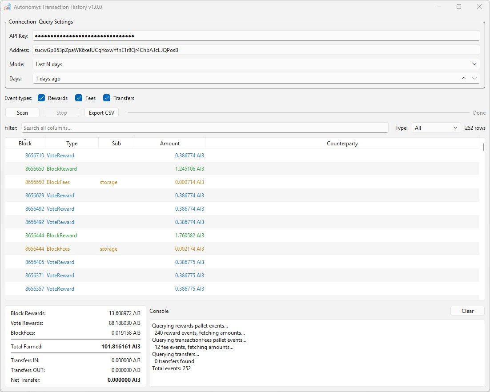

# pyAutonomysTransactionHistory

Windows desktop utility (PySide6) for querying on-chain transaction and farming reward history for a Subspace (Autonomys) address via the Subscan API.



## What it does

- Connects to the [Subscan API](https://pro.subscan.io/) (`autonomys.api.subscan.io`) — no local node required.
- Fetches three categories of on-chain activity for a given address:
  - **Rewards** — `Rewards.BlockReward` and `Rewards.VoteReward` events (farming income).
  - **Fees** — `TransactionFees.BlockFees` (storage, compute, and tips earned by the block author).
  - **Transfers** — `Balances.Transfer` events (regular token sends and receives).
- Displays results in a sortable, filterable table with color-coded event types.
- Shows a live summary panel with totals broken down by category.
- Exports results to CSV.

## Requirements

- Windows
- Python 3.x
- `pip`
- A free [Subscan API key](https://pro.subscan.io/) (registration required)
- Dependencies from `requirements.txt`:
  - `PySide6`
  - `requests`
  - `ag95[LoggingScripts]`

## Quick start

### Option A: Use the provided installer script

```powershell
.\Install.bat
```

This creates `venv`, links `activate.bat`, upgrades `pip`, and installs requirements.

### Option B: Manual setup

```powershell
python -m venv venv
.\venv\Scripts\Activate.ps1
python -m pip install --upgrade pip
python -m pip install -r requirements.txt
```

## Run from source

```powershell
.\venv\Scripts\Activate.ps1
python .\main.py
```

## How to use

1. Enter your [Subscan API key](https://pro.subscan.io/) (saved across sessions in `settings.json`).
2. Enter the Subspace address to scan (SS58 prefix 6094).
3. Choose a query mode:
   - **Last N days** — looks back N days from the latest block (~13,500 blocks/day at ~6.4s avg block time).
   - **Block range** — specify exact start/end block numbers.
   - **Entire history** — scans every indexed block (may take a while).
4. Toggle the event types you care about: **Rewards**, **Fees**, **Transfers**.
5. Click **Scan**.
6. Filter results by typing in the search box or using the type dropdown.
7. Click column headers to sort.
8. **Export CSV** saves the current results to a file.

## Output and state files

- `settings.json` — persisted API key, address, and query preferences.
- `runtime_log.log` — application log.

## Build executable (PyInstaller)

```powershell
.\BUILD_release.bat
```

Build config is in `main.spec`.

## Project entry points

- `main.py` — Qt app startup
- `frontend.py` — GUI layout, table model, filter proxy, and user interactions
- `backend.py` — Subscan v2 API client, batch event-params fetcher, and `ScanWorker` QThread

## How it works under the hood

The app uses Subscan's v2 API endpoints:

| Endpoint | Purpose |
|---|---|
| `POST /api/scan/metadata` | Resolve latest block number |
| `POST /api/v2/scan/events` | Fetch paginated events by pallet (`rewards`, `transactionfees`) filtered by address and block range |
| `POST /api/scan/event/params` | Batch-fetch decoded event parameters (amounts, accounts) |
| `POST /api/v2/scan/transfers` | Fetch paginated transfer records |

Rate limiting is handled with 650 ms sleeps between pages and exponential-backoff retries on 429/403 responses. The free Subscan tier caps responses at 25 rows per page.

## Support

If this tool is useful to you, consider sending a donation:

```
sucwGpB53pZpaWK6xeJUCqYoxwYfnE1r8Qr4ChbAJcLJQPosB
```

## License

MIT
